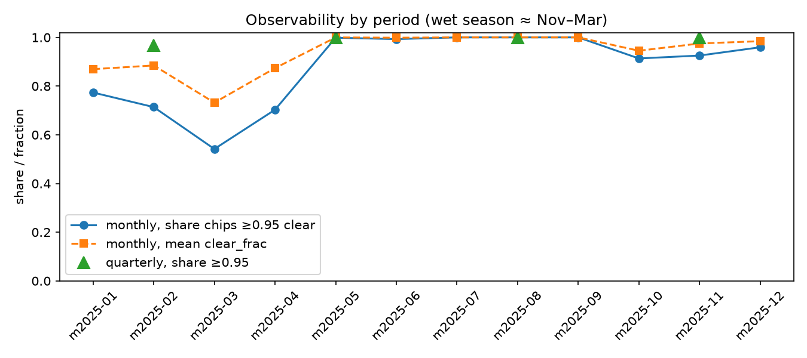
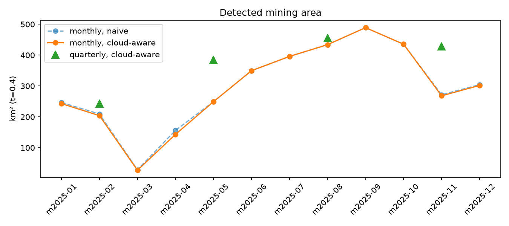
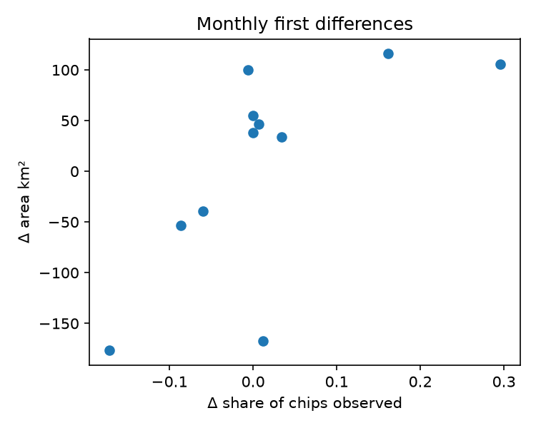
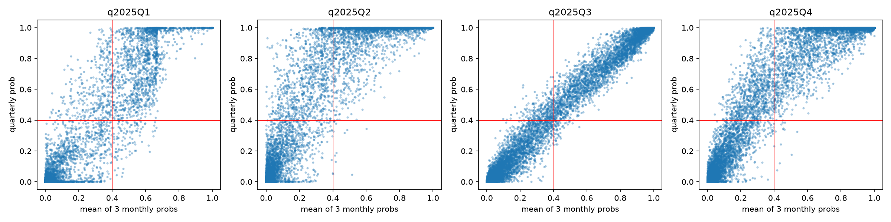
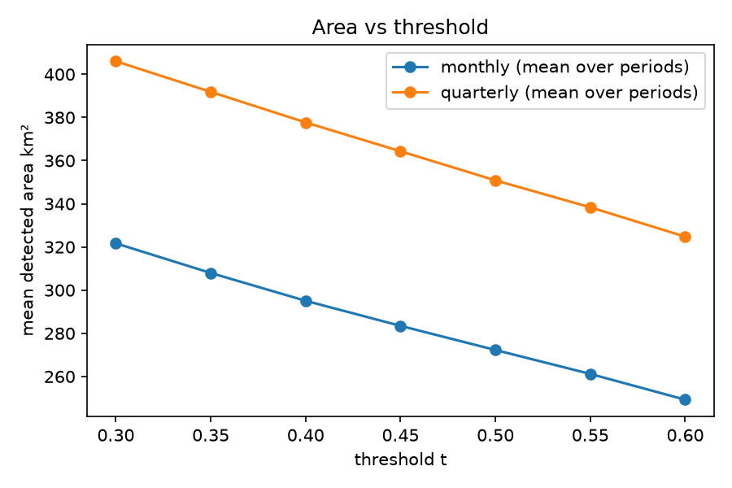

# Monthly vs quarterly composites — pilot analysis
_Generated 2026-07-29 10:14; 16 periods, 42320 chips, 677120 chip-period rows._

Definitions: chip = 480 m × 480 m window (stride 240 m, overlapping); observed = clear_frac ≥ 0.95; working threshold t = 0.4 (model config); areas = dissolved unions in EPSG:32719. Read the docstring of analysis.py for the methodological cautions that govern interpretation of every section below.

## A. Cloud coverage & missingness (the case for the cloud flag)

Chip counts as *observed* if `clear_frac >= 0.95` (sensitivity: 0.5).

```
      cadence    period  n_chips  mean_clear_frac  share_fully_obs  share_half_obs  share_fully_missing  mean_n_clear
0     monthly  m2025-01    42320            0.870            0.774           0.877                0.044         2.048
1     monthly  m2025-02    42320            0.885            0.714           0.907                0.011         2.044
2     monthly  m2025-03    42320            0.732            0.542           0.750                0.113         1.297
3     monthly  m2025-04    42320            0.874            0.703           0.894                0.013         2.467
4     monthly  m2025-05    42320            1.000            0.999           1.000                0.000         6.340
5     monthly  m2025-06    42320            0.999            0.993           1.000                0.000         3.916
6     monthly  m2025-07    42320            1.000            1.000           1.000                0.000        12.511
7     monthly  m2025-08    42320            1.000            1.000           1.000                0.000        10.038
8     monthly  m2025-09    42320            1.000            1.000           1.000                0.000        10.909
9     monthly  m2025-10    42320            0.945            0.913           0.947                0.025         4.755
10    monthly  m2025-11    42320            0.975            0.925           0.983                0.001         4.317
11    monthly  m2025-12    42320            0.984            0.959           0.988                0.002         3.478
12  quarterly   q2025Q1    42320            0.991            0.968           0.995                0.000         5.389
13  quarterly   q2025Q2    42320            1.000            1.000           1.000                0.000        12.722
14  quarterly   q2025Q3    42320            1.000            1.000           1.000                0.000        33.458
15  quarterly   q2025Q4    42320            1.000            1.000           1.000                0.000        12.550
```



Distribution of #months (of 12) each chip is fully observed — chips at the low end are *chronic* gaps (interpolation there is extrapolation):

```
     n_chips
obs         
6         49
7        652
8       2427
9       5290
10      9234
11     14947
12      9721
```

## B. Empirical verification: cloud gap == all-zero pixels

Per-tile disagreement between `N_CLEAR==0` (coverage raster) and `all 13 bands == 0` (imagery): mean 0.000781, max 1.000000 over 1280 tile-periods.

Interpretation: values ≈ 0 CONFIRM the pipeline card's assumption that Earth Engine fills fully-masked pixels with 0, and that the all-zero heuristic is a valid retroactive cloud flag for already-cached imagery. Non-negligible values would mean gaps are only reliably identifiable via the coverage raster (keep using it either way — it also gives N_CLEAR as a precision measure).

## C. Detected mining area: naive vs cloud-aware

`area_naive` uses ALL chips (as the raw pipeline would); `area_observed` restricts to chips with clear_frac ≥ 0.95. The DIFFERENCE is the mechanical cloud artefact a naive series would carry. Areas are km² of the dissolved union of positive 480 m chips (union, not sum — chips overlap by construction).

```
      cadence    period  area_naive_km2  area_observed_km2  n_pos_naive  n_pos_observed  share_chips_observed
0     monthly  m2025-01         246.703            243.007         3052            2989                 0.774
2     monthly  m2025-02         209.383            204.048         2537            2443                 0.714
4     monthly  m2025-03          28.817             27.261          310             289                 0.542
6     monthly  m2025-04         156.204            143.225         1582            1422                 0.703
8     monthly  m2025-05         249.158            249.158         2930            2930                 0.999
10    monthly  m2025-06         349.736            349.504         4358            4355                 0.993
12    monthly  m2025-07         395.884            395.884         5035            5035                 1.000
14    monthly  m2025-08         434.005            434.005         5497            5497                 1.000
16    monthly  m2025-09         489.058            489.058         6270            6270                 1.000
18    monthly  m2025-10         435.464            435.464         5539            5539                 0.913
20    monthly  m2025-11         271.586            268.229         3367            3316                 0.925
22    monthly  m2025-12         304.304            301.866         3859            3831                 0.959
24  quarterly   q2025Q1         242.891            242.891         2916            2916                 0.968
26  quarterly   q2025Q2         384.502            384.502         4893            4893                 1.000
28  quarterly   q2025Q3         455.014            455.014         5796            5796                 1.000
30  quarterly   q2025Q4         428.354            428.354         5532            5532                 1.000
```



- **monthly** cloud-aware series: mean 295.1 km², CV 0.455, mean |Δ| between consecutive periods 84.7 km², lag-1 autocorr 0.73 (n=12 — descriptive only).
- **quarterly** cloud-aware series: mean 377.7 km², CV 0.250, mean |Δ| between consecutive periods 79.6 km², lag-1 autocorr 0.75 (n=4 — descriptive only).

## D. Confounding: does apparent change track cloud cover?

First differences, monthly, cloud-aware series (n=11 pairs):
- Spearman ρ(Δarea, Δcoverage) = 0.60 (p=0.05, exact p-values unreliable at this n; read the sign and size).
- OLS: Δarea = -4.1 + 559.9·Δcoverage, R²=0.45.

If ρ is clearly positive, month-to-month movements in the *cloud-aware* series still co-move with observability — i.e. compositional missingness (WHICH chips are observable changes month to month) leaks into the series. The fix in the econometric stage is a balanced-panel estimator (only chips observed in both adjacent months contribute to Δ) or explicit imputation — not deletion.



Chip-level: 14388 month-to-month classification flips at t=0.4 among consecutively-observed chips. |Δclear_frac| for flippers vs stable chips: medians 0.000 vs 0.000 (Mann-Whitney one-sided p=0.000). A clear gap would implicate residual partial-cloud noise (chips passing the τ=0.95 filter but still degraded).

## E. Monthly ↔ quarterly consistency

Comparisons are restricted to chips fully observed in the quarter AND in all three constituent months (balanced subsample) — disagreement here cannot be blamed on missingness, only on composite non-linearity, temporal aggregation, and noise.

```
   quarter  n_balanced_chips  spearman_q_vs_meanM  MAE_prob  kappa_q_vs_meanM  kappa_q_vs_anyM  IoU_footprint_q_vs_anyM  pos_rate_q  pos_rate_meanM  pos_rate_anyM
0  q2025Q1             14524                0.742     0.041             0.855            0.848                    0.804       0.133           0.115          0.164
1  q2025Q2             29536                0.781     0.042             0.800            0.921                    0.867       0.110           0.077          0.107
2  q2025Q3             42320                0.874     0.010             0.966            0.928                    0.887       0.137           0.132          0.152
3  q2025Q4             34543                0.810     0.030             0.876            0.945                    0.905       0.140           0.114          0.145
```



Reading guide: high ρ/κ with `pos_rate_anyM > pos_rate_q` is the expected pattern if monthly composites are noisier — 'any month positive' accumulates false positives 3 chances instead of 1. If instead `pos_rate_q` exceeds `anyM`, the quarterly composite is genuinely more sensitive (median over more clear scenes → cleaner signal), which argues for quarterly anchors in the econometric model.

## F. Within-quarter dispersion: an upper bound on monthly noise

IDENTIFYING ASSUMPTION (state it, defend it, doubt it): true mining extent at a 480 m chip changes little WITHIN a quarter, so the dispersion of a chip's three monthly probabilities mostly reflects measurement noise (composite quality, atmospheric residuals). This is defensible for established pits, weakest during rapid frontier expansion — where within-quarter change is real. The bound is therefore an UPPER bound on noise.

```
   quarter  n_chips_balanced  median_sd_prob  p90_sd_prob  flip_rate_within_q  median_sd_conf_neg  median_sd_conf_pos
0  q2025Q1             14524             0.0        0.425               0.149                 0.0               0.505
1  q2025Q2             29536             0.0        0.141               0.076                 0.0               0.369
2  q2025Q3             42320             0.0        0.073               0.037                 0.0               0.007
3  q2025Q4             34543             0.0        0.134               0.066                 0.0               0.095
```

`flip_rate_within_q` = share of balanced chips whose classification at t=0.4 is not constant across the quarter's three months. `median_sd_conf_neg/pos` isolate chips the quarterly composite scores confidently (<0.1 / >0.9): dispersion THERE is almost surely pure noise. If the confident-chip sd is small but the overall flip rate is high, monthly noise is concentrated near the decision boundary — an argument for using the continuous prob (not the 0/1 flag) in the econometric model.

## G. Threshold sensitivity

Mean share of observed chips within ±0.05 of t=0.4 (chips whose classification is fragile to the threshold choice):

```
           share_near_threshold
cadence                        
monthly                   0.008
quarterly                 0.009
```

If the monthly share exceeds the quarterly share, monthly composites push more probability mass toward the decision boundary — the fingerprint of noisier inputs.



## H. Does composite precision rise with clear-scene count?

Mechanism: the median over k clear scenes has sampling variance falling in k. If monthly noise is driven by few-scene composites, chip-probability dispersion should DECLINE in `n_clear_mean`. We test this on quarterly-confident NEGATIVES (quarterly prob < 0.1) — for these, monthly variation is interpretable as noise.

```
  nclear_bin      n  p95_prob  mean_prob  share_above_t
0        1-2  66164     0.006      0.005          0.003
1        2-3  62667     0.008      0.004          0.002
2        3-5  80504     0.007      0.003          0.000
3        5-8  74159     0.016      0.004          0.001
4         8+  86302     0.017      0.004          0.001
```

`p95_prob` and `share_above_t` on known-negative chips are empirical FALSE-POSITIVE tendencies by scene count. A monotone decline justifies using `n_clear` as a precision weight (or observation-error variance) in the state-space/interpolation model rather than a binary include/exclude rule.

## I. Implications for the econometric interpolation strategy

1. **Never treat a low score under low `clear_frac` as a zero.** The detection output cannot distinguish 'no mine' from 'no data'; the cloud flag now makes the distinction explicit. Any monthly series must be built from (prob, clear_frac, n_clear) triples, not from thresholded detections alone.
2. **Missingness is seasonal, hence plausibly MNAR.** Section A documents the wet-season observability trough. Dropping cloudy months and interpolating linearly would systematically smooth over exactly the season where mining dynamics (river levels, access) differ. Prefer a model that treats clear_frac as an observation process: state-space / Kalman with time-varying observation noise (variance ∝ 1/n_clear, gated on clear_frac), or monthly estimates anchored to quarterly composites (section E tells you how much the two instruments disagree even without missingness).
3. **Use the continuous probability, not the binary flag, as the measurement.** Sections F–G locate monthly noise near the decision boundary; thresholding early converts small score noise into large area noise. Threshold once, at the end, on the smoothed series.
4. **Balanced-panel differencing.** For growth rates, difference only chips observed in both periods (section D shows why); report the share of area carried by the balanced subsample alongside.

## J. Limitations (to carry into any write-up)

- One AOI (La Pampa corridor), one year, one model: no external validity claimed. The AOI was chosen for dense mining signal, i.e. non-randomly.
- CNN scores are the measurement instrument, not ground truth; all consistency results are internal. Validation against published AMW quarterly outputs and/or manual photo-interpretation is the natural next step.
- n = 12 months: all time-series statistics are descriptive; no significance claims should survive into the paper without more periods or more AOIs.
- Quarterly composites differ from monthly ones non-linearly (median over ~3× scenes); 'quarterly as truth' is an assumption of convenience in sections F/H, not a fact.
- Sentinel-2 revisit (~5 days) aliases sub-monthly dynamics; monthly 'signal' partly reflects WHICH days were clear (acquisition-timing noise), not only surface change.
